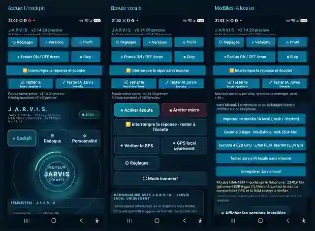

# Manuel FRIDAY Intelligence+ 3.14.20 Preview

> **Édition Android de test**, publiée dans [GitHub Releases](https://github.com/philippe015/friday-assistant/releases/tag/v3.14.20-friday-intelligence-preview). Cette version n'est pas une publication Google Play.

**Télécharger l'APK :** [FRIDAY-3.14.20-IntelligencePlus-Preview.apk](https://github.com/philippe015/friday-assistant/releases/download/v3.14.20-friday-intelligence-preview/FRIDAY-3.14.20-IntelligencePlus-Preview.apk) · [SHA-256 publié](https://github.com/philippe015/friday-assistant/releases/download/v3.14.20-friday-intelligence-preview/SHA256SUMS.txt)

## 1. Compatibilité et installation

- Android **8.0 minimum**, téléphone **ARM64**.
- Nom affiché : **FRIDAY · 3.14.20 Preview** ; identifiant : `fr.friday.assistant.v31420preview`.
- **Aucun ordinateur ni Termux n'est nécessaire.** Les modèles Vosk et IA ne sont pas inclus dans l'APK : les installer/importer séparément sur le téléphone.
- Cette édition s'installe **à côté** des anciennes éditions. Les réglages, autorisations, historiques chiffrés et modèles ne sont pas partagés entre les identifiants Android.
- La signature debug n'est pas forcément stable d'une compilation à l'autre. Ne désinstallez pas une version qui fonctionne sans réfléchir à la conservation de ses données.

**Procédure :** téléchargez le fichier APK depuis la Release GitHub, ouvrez-le dans *Téléchargements*, accordez l'autorisation « Installer depuis cette source » si Android la demande, lancez FRIDAY puis autorisez le microphone. Une notification de service au premier plan peut être demandée selon Android.

## 2. Comprendre les deux zones d'interface

Les captures d'écran de cette version montrent **une barre de commandes Android native en haut** et **le cockpit J.A.R.V.I.S. dans la zone WebView en dessous** : les deux appartiennent à la même application et peuvent proposer des commandes proches.

| Commande visible | Fonction |
| --- | --- |
| **Réglages** | Configurer l'écoute, la voix, le Web et les modèles |
| **Versions** | Voir les éditions Android connues ou installées |
| **Profil** / **Personnalité** | Choisir le profil de réponse |
| **Écoute ON / OFF écran** | Gérer l'écoute selon l'état de l'écran et les autorisations |
| **Activer écoute** | Démarrer ou relancer l'écoute du microphone |
| **Arrêter micro** / **Stop** | Couper l'écoute ; ne pas confondre avec l'interruption de la synthèse vocale |
| **Interrompre la réponse et écouter** | Interrompre une réponse prononcée et rendre la main à l'utilisateur |
| **Tester le haut-parleur** | Vérifier la sortie de synthèse vocale Android |
| **Tester IA Jarvis locale** | Exécuter un test de génération sur l'appareil |
| **Vérifier le GPS** / **GPS local seulement** | Tester l'accès à la localisation avec autorisation explicite |
| **Mode immersif** | Agrandir la zone d'interface du cockpit |

**Limite visuelle observée sur les captures :** sur un écran étroit, des boutons natifs et leur texte apparaissent parfois coupés, et le cockpit affiche encore des libellés hérités de **JARVIS 3.14.18**. L'identifiant de l'APK en haut (`v3.14.20-preview`) est la bonne référence pour cette édition ; ce décalage d'affichage mérite un futur correctif.

## 3. Configurer l'IA locale

1. Ouvrez **Réglages**, puis la section **Jarvis local**.
2. Appuyez sur **Importer un modèle IA local (.task / .litertlm)**.
3. Sélectionnez un modèle **compatible** stocké dans les fichiers Android.
4. Attendez l'importation complète et utilisez **Tester Jarvis IA locale sans Internet**.
5. Si la génération réussit, choisissez **Enregistrer Jarvis local** ou validez les paramètres correspondants.

Deux options apparaissent sur la capture :

- **Gemma 3 léger — MediaPipe .task (~304 Mo)**, pour un premier essai sur des téléphones moins puissants.
- **Gemma 4 E2B GPU — LiteRT-LM .litertlm (~2,34 Go)**, qui requiert davantage d'espace, de RAM et un GPU compatible. Une confirmation d'import ne prouve pas encore que l'inférence GPU fonctionnera.

**Le nom du modèle technique peut être consulté dans les réglages et diagnostics.** FRIDAY essaie de préserver sa personnalité dans les réponses ordinaires, mais il ne doit pas cacher le vrai moteur lorsque l'utilisateur l'interroge directement.

## 4. Tester l'écoute et la météo

Dans la version 3.14.20, commencez par :
1. **Tester le haut-parleur** et vérifier les permissions du micro.
2. Activer **Écoute**. Demander « **Friday, donne-moi la météo de ce soir** ».
3. Si FRIDAY demande une ville, répondre clairement « **Vitry-sur-Seine ce soir** ».
4. Contrôler que la réponse indique une **plage horaire du soir**, et non seulement les températures min/max de toute la journée.
5. Vérifier que le microphone revient à l'écoute après la lecture de la réponse.

FRIDAY prévoit une fenêtre courte pour répondre à une demande de ville sans répéter le mot d'activation. Les mots isolés peuvent être ignorés par le filtre Vosk : ce n'est pas nécessairement une panne du micro. Les résultats météo proviennent d'un service externe ; ils exigent donc Internet.

## 5. Confidentialité et problèmes connus

Les échanges, les réglages et la mémoire peuvent rester chiffrés sur le téléphone. **Activer la recherche Web ou les lieux proches peut envoyer des termes de recherche et, pour une recherche géographique autorisée, des données de localisation à des services tiers** : l'IA locale n'implique pas que toutes les fonctions sont hors ligne.

L'export de rapport de conversation peut contenir les questions personnelles en clair : **ne publiez pas un export JSON brut dans une issue GitHub publique**. Préférez les codes diagnostiques expurgés ou envoyez le rapport dans un échange privé.

Points restant à tester : conflits Android d'acquisition du microphone, stabilité des modèles LiteRT-LM GPU, reprises d'écoute en arrière-plan, légendes et boutons coupés sur petit écran, météo lorsque le serveur est indisponible. Le téléchargement ou l'importation d'un modèle ne garantit pas sa compatibilité.

## 6. Captures réelles de l'application

  

De gauche à droite : **accueil / cockpit**, **commandes d'écoute et microphone**, **importation d'un modèle IA local**.

Ces **trois captures ont été fournies par un utilisateur** et représentent une session réelle de FRIDAY 3.14.20 Preview sur Android. Elles ne constituent pas une preuve de stabilité fonctionnelle.

## 7. Ressources

- [Télécharger l'APK / voir la release](https://github.com/philippe015/friday-assistant/releases/tag/v3.14.20-friday-intelligence-preview)
- [Code et correctifs FRIDAY Intelligence+ (PR #114)](https://github.com/philippe015/friday-assistant/pull/114)
- [Branche de préparation de l'APK (PR #115)](https://github.com/philippe015/friday-assistant/pull/115)
- [Signaler un problème](https://github.com/philippe015/friday-assistant/issues)

---
**Projet indépendant et open source.** FRIDAY / JARVIS est un assistant Android expérimental ; aucune affiliation à une franchise de fiction ou à un constructeur de modèles n'est revendiquée.
